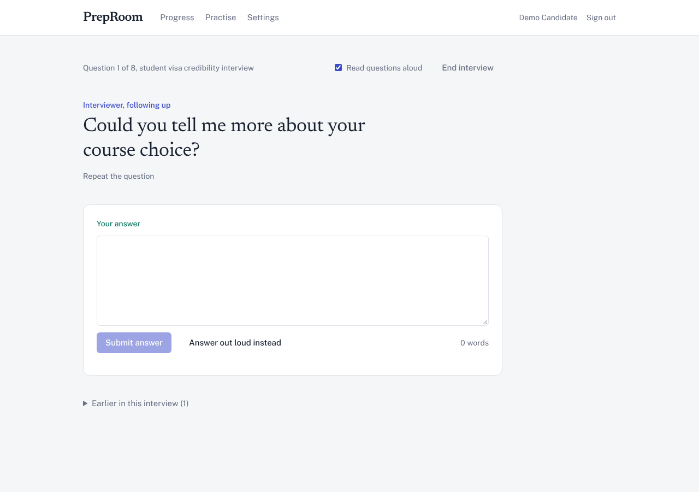
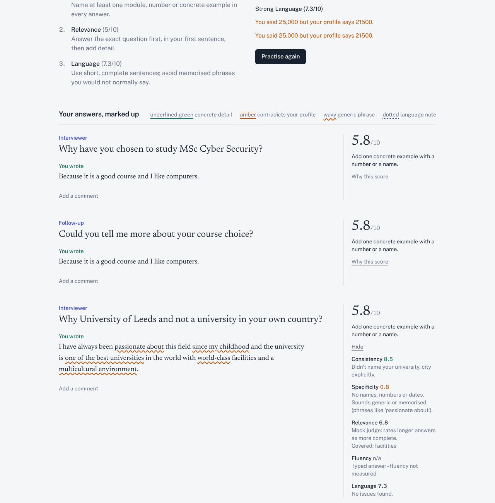
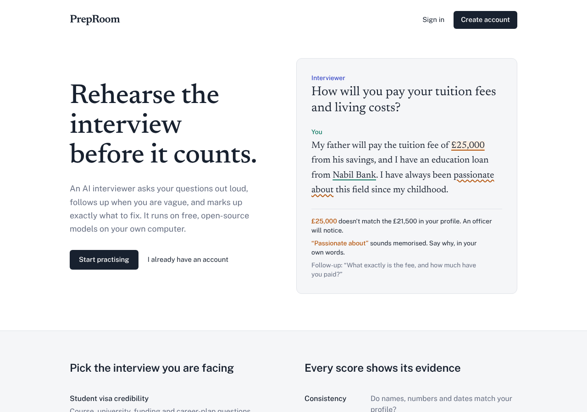
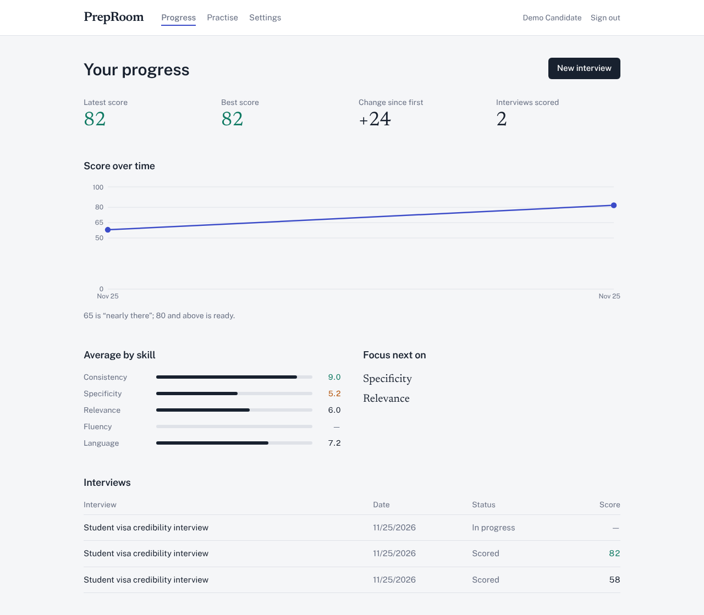
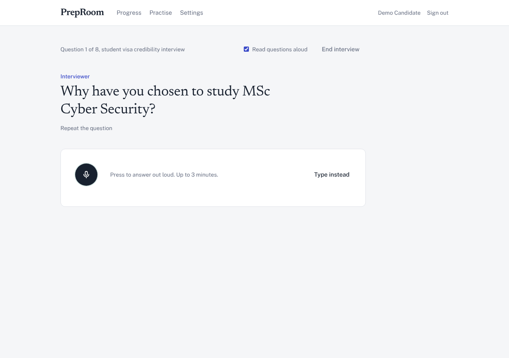
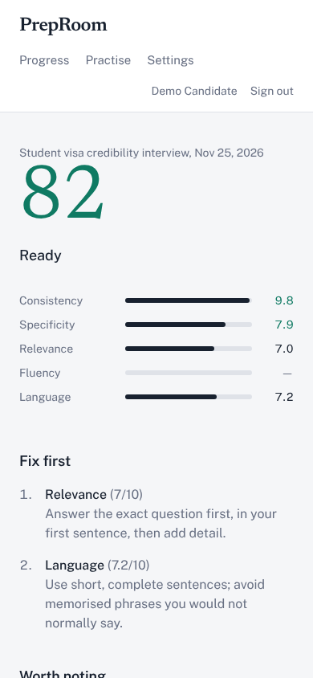
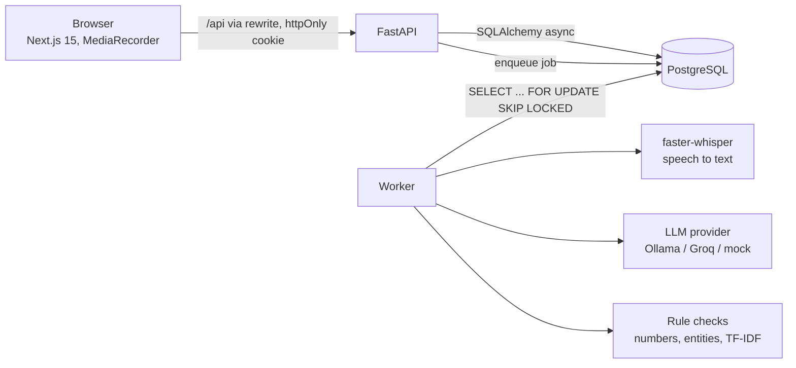

# PrepRoom

**Practise interviews out loud with an AI interviewer that asks follow-ups, checks your answers against your own facts, and shows you exactly which words helped or hurt. Runs entirely on free, open-source models.**


| Interview room | Marked-up report |
|---|---|
|  |  |

<details>
<summary>More screenshots (landing page, dashboard, interview room, mobile report)</summary>

| Landing page | Dashboard |
|---|---|
|  |  |

| Interview room | Report on mobile |
|---|---|
|  |  |

</details>

## Why

Interview practice tools are either generic chatbots that praise everything, or paid coaching. Candidates for visa, university and job interviews need something in between: an interviewer that presses on vague answers, notices when they say a different number from the one on their documents, and tells them what to fix next time.

PrepRoom is built around **interview packs**: plain YAML files that define the persona, questions, follow-up rules, profile fields and scoring rubric. Four ship built in:

| Pack | What it checks |
|---|---|
| Student visa credibility | Course, university, funding and career plans, and that numbers match your documents |
| University admission | Motivation, academic fit, research interests |
| Job interview, behavioural | STAR-style stories with real outcomes |
| Technical concepts | Explaining CS / security concepts clearly |

Admins can upload new packs from the UI; they are validated before they go live.

## What it does

- **Live interview room**: questions are read aloud (browser speech synthesis); answer by voice or typing. Recording shows a live level ring.
- **Adaptive follow-ups**: short, vague, off-topic or contradictory answers trigger one follow-up, written by the LLM and grounded in the pack.
- **Consistency checks**: numbers and named entities in your answer are compared with the profile you filled in ("You said 25,000 but your profile says 21,500").
- **Memorised-answer detection**: TF-IDF similarity against known template answers, plus stock phrases ("passionate about since my childhood").
- **Delivery metrics** from Whisper word timestamps: words per minute, long pauses, filler words.
- **Marked-up transcript**: concrete details underlined green, contradictions amber, generic phrases wavy, language notes dotted, each with an explanation.
- **Report and progress**: five sub-scores weighted by the pack rubric, top fixes with tips, a readiness band, and a trend chart across sessions.
- **Coach mode**: a candidate can grant a coach access; coaches see their candidates' reports and leave comments on individual answers.

## Architecture



- **No Redis.** The job queue is a Postgres table claimed with `FOR UPDATE SKIP LOCKED`, with retries, exponential backoff and a dependency wait (the report job waits until every answer is scored). Fewer moving parts, and tested with concurrent workers.
- **The LLM is never trusted alone.** The judge must return JSON matching a Pydantic schema (one retry, then a rules-only fallback). Every quote it cites is checked against the actual answer and dropped if it isn't there. Candidate answers are passed as data inside delimiters, not as instructions.
- **Typed end to end.** The web client types are generated from the API's OpenAPI schema; CI fails if the schema drifts.

### Scoring

| Sub-score | Source |
|---|---|
| Consistency | Numeric and entity contradictions against the profile (capped at 3/10 on any contradiction) plus LLM-detected ones |
| Specificity | Names, numbers, dates and modules mentioned; penalised for generic or memorised phrasing |
| Relevance | LLM judge plus coverage of the keywords the question expects |
| Fluency | Words per minute, pauses and fillers (voice answers only; typed answers re-weight the rest) |
| Language | LLM grammar corrections plus simple heuristics |

## Run it

### Docker (recommended)

```bash
cp .env.example .env          # set JWT_SECRET
make up-ollama                # Postgres, API, worker, web, Ollama + pulls qwen2.5:7b
make demo                     # demo accounts and two scored interviews
open http://localhost:3000    # candidate@preproom.dev / preproom-demo-2026
```

No GPU? Use a free hosted model instead: set `LLM_PROVIDER=openai_compatible` and a Groq API key in `.env`, then `make up`. For a quick look with no AI at all, `LLM_PROVIDER=mock STT_PROVIDER=mock`.

### Local development

```bash
cd api && pip install -e ".[dev,voice]" && alembic upgrade head
make api-dev    # :8000, docs at /docs
make worker-dev
cd web && npm install && make web-dev   # :3000
```

### Tests

```bash
make test       # 42 API tests (93% coverage, SQLite and Postgres) + web unit tests
cd web && npx playwright test           # full sign-up -> interview -> report journey
```

## Security

Argon2 password hashing, JWT in an httpOnly SameSite cookie, role-based access (candidate / coach / admin) with per-candidate coach grants, login rate limiting and no account enumeration, upload type and size limits with server-chosen filenames, strict security headers, non-root containers, and `pip-audit` / `npm audit` in CI.

## Honesty

PrepRoom is a practice tool. It helps people explain their real situation clearly; it does not write answers for them and it flags memorised scripts. Scores are an estimate from open models, not a prediction of any official decision.

## Limitations

- Small local models occasionally miss nuance; the rule checks catch the factual issues, the LLM handles tone and relevance.
- Whisper `small` on CPU takes a few seconds per answer. Use `base` for speed or `medium` for accuracy.
- English only for now.

See [docs/DECISIONS.md](docs/DECISIONS.md) for design decisions and trade-offs.

## License

MIT
